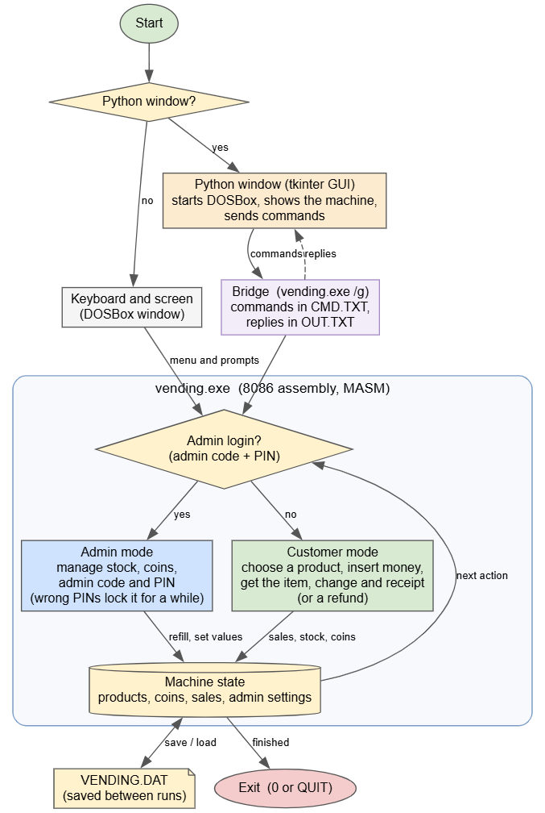
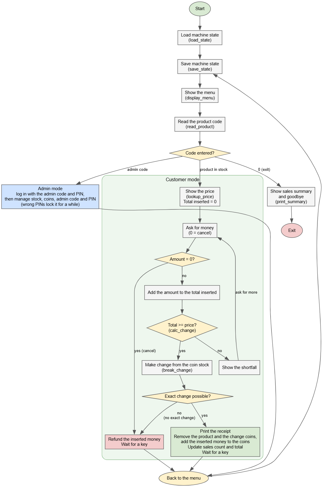

# Vending Machine Simulator (8086 Assembly)

A console vending machine written in 16-bit 8086 assembly (MASM syntax). It shows a product menu, takes a product code, accepts payment (in several steps, with cancel and refund), works out the change, breaks it into 100 / 50 / 20 / 10 / 5 / 1 coins taken from the machine's coin stock, and prints a receipt. Products can sell out, the machine keeps a coin inventory, a PIN-protected admin mode (with a lockout after wrong PINs) restocks it and can change its own code and PIN, and stock, coins, sales and admin settings are saved to a file between runs. Several purchases can be made in one run.

It is assembled with **JWasm** and runs in **DOSBox**. The build script is a Windows `.bat` file, so the steps below are for **Windows**.

A Python window (`gui\vending_gui.py`) can drive the same program, see [Graphical interface](#graphical-interface-python).

> New to the project? Follow the **Quick start**. If anything goes wrong, [Setup.md](Setup.md) has the full install guide and a troubleshooting table.

---

## Quick start

You need **Git**, **JWasm** and **DOSBox**. [Setup.md](Setup.md) explains where to get them.

**1. Clone the repository and open a terminal in its folder** (PowerShell or the VS Code terminal):

```powershell
git clone <repository URL>
cd <repository folder>
```

**2. Check that JWasm is in place.** This file must exist:

```text
tools\JWasm\JWasm.exe
```

If it is missing, see *Step 2* in [Setup.md](Setup.md).

**3. Build the program:**

```powershell
.\build.bat vending
```

This creates `vending.exe` in the project folder. The first run also creates a save file, `VENDING.DAT`, in that folder.

**4. Run it in DOSBox.** Start DOSBox and type these three lines, using the real path of your project folder:

```text
mount d "C:\path\to\your\project folder"
d:
vending.exe
```

**5. Try a purchase.** Enter `1` (Chips), then `50`. You should see a receipt with change of 35. Enter `0` at the menu to exit; a summary of the sales made is shown.

**6. Try the window (optional).** With Python 3 installed, run `py gui\vending_gui.py` from the project folder. It starts DOSBox and the program by itself and shows the machine in a window (see [Graphical interface](#graphical-interface-python)).

> The built `.exe` files are **not** stored in the repository. You must run `build.bat` yourself after cloning, and again whenever the code changes (for example after `git pull`).

---

## Using the program

1. The screen clears and the menu appears. A product with no stock left is marked `(sold out)`.
2. Enter a product code (`1` to `6`), or `0` to exit. Choosing a sold-out product shows a message and asks again.
3. The price is shown. Enter an amount of money to insert (up to 999 per insertion), or `0` to cancel.
4. If the money is not enough, the shortfall is shown and you are asked for more. New amounts are **added** to what you already inserted.
5. When the total covers the price, the change is made from the machine's coins and a receipt is printed with the change broken into 100 / 50 / 20 / 10 / 5 / 1 coins.
6. The product leaves the stock, the change coins leave the coin stock, and the inserted money is added to the coin stock.
7. Press any key to return to the menu.
8. Cancelling refunds any money inserted so far. If the machine does not have the coins for exact change, nothing is sold and the money is refunded.
9. Exiting shows the number of sales made and the total taken (running totals, kept across runs).

The machine starts full: 3 units of each product and 10 coins of each denomination. While typing a number, Backspace erases the last key typed.

| Code | Product | Price |
|---|---|---|
| 1 | Chips | 15 |
| 2 | Soda | 25 |
| 3 | Candy | 10 |
| 4 | Water | 20 |
| 5 | Coffee | 30 |
| 6 | Juice | 35 |

Example session (abbreviated; exact blank lines may differ):

```text
==== VENDING MACHINE ====
1. Chips    -  15
2. Soda     -  25
3. Candy    -  10
4. Water    -  20
5. Coffee   -  30
6. Juice    -  35
0. Exit

Enter product code: 5
Price: 30
Insert money (0 to cancel): 10
Insufficient funds. Short by: 20
Insert money (0 to cancel): 25

======== RECEIPT ========
Item:   Coffee
Price:  30
Paid:   35
Change: 5
1 x 5
=========================
Press any key to continue...
```

Invalid input (letters, an empty line, a number over 999 at a payment prompt, or a product code outside 0 to 6) shows an error and asks again.

### Admin mode

Type the admin code at the product prompt (default `31415`). The program then asks for the PIN (default `1234`), which is shown as `*`. Typing `0` at the PIN prompt goes back to the menu.

- A wrong PIN says how many tries are left and asks for the PIN again, not the admin code.
- After 3 wrong PINs in a row the admin is locked. While it is locked, typing the admin code only shows the time left.
- The lock lasts 1, 5, 10, 20 and 30 minutes, then 60 minutes each time after that. A correct PIN clears the count and starts the sequence again from 1 minute.
- The lock is kept in memory only, so restarting the program clears it. The lock times are the `lock_times` table in `inc\data.inc`; the number of tries is `PIN_TRIES`.

The admin menu offers:

| Choice | Action |
|---|---|
| 1 | View product stock, coins and sales |
| 2 | Refill all products |
| 3 | Refill all coins |
| 4 | Set the stock of one product (the product list is shown first) |
| 5 | Set the coins of one denomination |
| 6 | Change the admin code |
| 7 | Change the PIN |
| 0 | Leave admin mode |

Choices 6 and 7 ask for the new value twice (the PIN is shown as `*`). `0` cancels, and two entries that do not match change nothing. The admin code must be at least 10 and the PIN must be 1000 to 9999. The defaults are `DEFAULT_ADMIN_CODE` and `DEFAULT_ADMIN_PIN` in `inc\data.inc`; once changed, the new values are stored in the save file.

### Save file

The product stock, coin stock, sales count and total, admin code and PIN are written to `VENDING.DAT` every time the menu is shown and are loaded at the next start. Sales totals therefore count across runs (they are 16-bit numbers and wrap after 65535). The admin code and PIN are stored as plain numbers, so the file is not secure. If the layout of the saved data changes between versions, the old file is ignored and rewritten. The file is created in the folder the program runs from (the folder mounted in DOSBox). To reset the machine to full stock with the default admin code and PIN, delete `VENDING.DAT`.

---
## Vending Machine Logic and Workflow

  <h3 align="center">Overview</h3>
  <p align="center"></p>
  <h3 align="center">Workflow</h3>
  <p align="center"></p>


---

## Graphical interface (Python)

The window is a front end for the same program. `vending.exe` runs in DOSBox in *bridge mode* (`vending.exe /g`), and the window sends it commands and draws the answers, so all the selling, stock, coin and PIN logic stays in assembly.

**Needs:** Windows, Python 3 with tkinter (tested with 3.13; the python.org installer includes tkinter), and DOSBox (DOSBox-X also works). Build the program first (`.\build.bat vending`).

```text
py gui\vending_gui.py            starts DOSBox and vending.exe /g by itself
py gui\vending_gui.py --manual   you start vending.exe /g in DOSBox yourself
```

Closing the window stops the program and DOSBox.

**Customer tab**

- One card per product with its code, name, price and stock. A sold-out product is grayed out. Click a card to start a purchase.
- The black display shows the messages (what to do next, how much more to insert, errors).
- The money buttons insert that amount (default 1, 5, 10, 20, 50 and 100). They are disabled until a product is chosen. There is no free amount box.
- **Cancel and refund** ends the purchase and gives back what was inserted.
- After a sale the receipt area shows the item, price, paid, change and the coins given back.

**Admin tab**

- The admin logs in with the admin code and the PIN (both are shown as `*`). A wrong code or PIN shows the tries left, and after 3 wrong tries a live countdown shows how long the admin is locked.
- After login: product stock and coin tables with a Set button for each row, Refill all products, Refill all coins, the sales count and total, and change admin code and change PIN (each new value is typed twice).
- Leaving the Admin tab logs the admin out and empties every box of the tab.
- Opening the Admin tab while a purchase is open is refused: the purchase is cancelled and refunded, and the window stays on the Customer tab.
- Opening the Admin tab clears the black display and the receipt.

**Settings.** Everything you may want to change is in `gui\settings.py`. Edit it, save it and start the window again; nothing needs to be rebuilt.

| Setting | What it changes |
|---|---|
| `PAY_BUTTONS` | the money buttons (each value from 1 to 999) |
| `AUTO_LAUNCH`, `DOSBOX_PATH`, `DOSBOX_MINIMIZED` | whether DOSBox is started by the window, where `DOSBox.exe` (or `dosbox-x.exe`) is, and whether its window is minimized |
| `PROJECT_FOLDER` | the folder with `vending.exe` (empty = the folder above `gui\`) |
| `WINDOW_TITLE`, `WINDOW_MIN_SIZE`, `CARD_COLUMNS` | the window title, its smallest size, products per row |
| `COLORS`, `FONT`, `FONT_BOLD`, `FONT_DISPLAY`, `FONT_RECEIPT` | colors and fonts |

Product names, prices and the machine's coin values are not in the settings: they come from the program (`inc\data.inc`), and the window shows whatever the program reports. The money buttons are independent of the machine's coins; inserted money is stored as the machine's own coins (for example a 100 is stored as one 100-coin).

If DOSBox is not found, the display says so; set `DOSBOX_PATH` or use `--manual`. The search tries `DOSBox.exe` in the usual folders and the `PATH`, and `dosbox-x.exe` last.

---

## Bridge mode and protocol

`vending.exe /g` starts the program without the keyboard menu. It loads the saved state and then answers commands that arrive in a file, until it receives `QUIT`. Without `/g` the program behaves as described above.

**Two files in the project folder** (both are created when bridge mode starts):

| File | Direction | Content |
|---|---|---|
| `CMD.TXT` | window to program | one record of 64 bytes: `SEQ|COMMAND args#`, padded with spaces |
| `OUT.TXT` | program to window | one record of 1024 bytes: `SEQ|`, the status line, data lines, then `#`, padded with spaces |

**Handshake rules**

- Every command gets a new sequence number (`SEQ`); the program answers each number once and the reply starts with the same number.
- The files are only ever overwritten in place and never created, deleted or renamed by the window, because DOSBox does not see files that appear in the folder while it runs.
- A command is only acted on once its end marker `#` is there. A reply is first wiped to spaces and its `#` is written last, so a half-written reply is never taken for a finished one.
- While a command runs, the program's text output is redirected into `OUT.TXT`, so the normal print routines write the reply.

**Commands**

| Command | What it does | Reply (after `SEQ|`) |
|---|---|---|
| `STATE` | snapshot of the machine | `OK`, then lines `P code name price stock` (per product), `C value count` (per coin), `S sales_count sales_total`, `L seconds_locked`, `A admin_session` (0 or 1), `X purchase_open product inserted` |
| `BUY n` | start a purchase of product n | `OK TX n price`; `ERR invalid`, `ERR soldout`, `ERR busy` |
| `PAY amount` | insert 1 to 999 | `OK SHORT missing`; or `OK SOLD` with a line `R item price paid change` and a line `K count coin` for each coin given; or `OK NOCHANGE refunded`; `ERR notx`, `ERR amount` |
| `CANCEL` | end the purchase | `OK REFUND amount` |
| `LOGIN code pin` | open an admin session | `OK`; `ERR WRONG tries_left`; `ERR LOCKED seconds` (same 3 tries and lockout as the keyboard) |
| `LOGOUT` | close the admin session | `OK` |
| `REFILL PRODUCTS`, `REFILL COINS` | refill everything (admin) | `OK`; `ERR login`, `ERR invalid` |
| `SETSTOCK product qty` | set one stock, qty up to 999 (admin) | `OK`; `ERR login`, `ERR invalid`, `ERR range` |
| `SETCOIN value qty` | set one coin count (admin) | `OK`; `ERR login`, `ERR invalid`, `ERR range`, `ERR denom` |
| `SETCODE n` | new admin code, at least 10 (admin) | `OK`; `ERR login`, `ERR invalid`, `ERR range` |
| `SETPIN n` | new PIN, 1000 to 9999 (admin) | `OK`; `ERR login`, `ERR invalid`, `ERR range` |
| `QUIT` | save and leave bridge mode | `OK` |

Anything else gets `ERR unknown`. Admin commands without a login get `ERR login`. Commands that change the machine also update `VENDING.DAT`.

**Python side.** `gui\bridge.py` is the client (`Bridge.command("PAY 10")` returns the parsed reply, `Bridge.state()` the whole machine). `gui\test_bridge.py` checks every command against a running `vending.exe /g`. `gui\pingpong.asm` and `gui\pingpong.py` are the small handshake test the protocol started from.

---

## Repository layout

```text
<project folder>\
|-- src\
|   `-- vending.asm        main program: includes all modules, contains main
|
|-- inc\                   modules, pasted into the program at assembly time
|   |-- data.inc           constants, tables, messages, variables (included first)
|   |-- utils.inc          print_str, newline, print_char, print_int, print_spaces, print_name_col, print_int3, clear_screen, wait_key
|   |-- lookup.inc         code_to_offset, lookup_price, lookup_name
|   |-- stock.inc          lookup_stock, take_stock, take_coins, put_coins
|   |-- input.inc          read_int, ask_int, read_product
|   |-- menu.inc           display_menu
|   |-- math.inc           calc_change, break_change
|   |-- output.inc         print_change, print_receipt, print_summary
|   |-- admin.inc          admin_mode, PIN lockout, admin code and PIN changes, and the admin menu actions
|   |-- file.inc           load_state, save_state
|   `-- bridge.inc         bridge mode: the /g switch and the CMD.TXT / OUT.TXT commands
|
|-- tests\                 standalone test programs (one per module)
|   |-- t_utils.asm        tests utils.inc
|   |-- t_lookup.asm       tests lookup.inc
|   |-- t_stock.asm        tests stock.inc
|   |-- t_input.asm        tests input.inc
|   |-- t_math.asm         tests menu.inc and math.inc
|   |-- t_output.asm       tests output.inc
|   |-- t_admin.asm        tests admin.inc
|   `-- t_file.asm         tests file.inc
|
|-- gui\                   the Python window and its link to the program
|   |-- vending_gui.py     the window (tkinter)
|   |-- settings.py        all settings of the window (buttons, colors, DOSBox)
|   |-- bridge.py          sends commands to vending.exe /g and reads the replies
|   |-- test_bridge.py     checks every bridge command
|   |-- pingpong.asm       first handshake test, DOS side
|   `-- pingpong.py        first handshake test, Python side
|
|-- tools\JWasm\           the assembler (JWasm.exe), see Setup.md
|-- build.bat              assembles one program: build <name>
|-- vending_flowchart.png  the flowchart shown in this file
|-- README.md              this file
|-- Setup.md               install guide and troubleshooting
|-- TEST_RESULTS.md        how to run the tests, and the recorded results
|-- .gitignore, .gitattributes
```

**Created on your machine, not stored in the repository:**

- the built programs (`*.exe`), made by `build.bat`;
- the save files (`*.dat`), such as `VENDING.DAT`, written when the program runs;
- the bridge files `CMD.TXT` and `OUT.TXT`, created each time bridge mode starts, and Python's `__pycache__\`;
- `docs\` (the project report and flowcharts), which the team keeps outside the repository;
- assembler leftovers such as `*.obj`, `*.lst` and `*.map`.

File names stay within 8 characters before the extension, because DOS cannot run longer names.

---

## How the code is organised

The code is split into module files. `vending.asm` pulls them in with the `include` directive, so **one build command** produces the whole program and no separate linking step is needed. Every module has exactly one test program.

### Calling convention

Arguments go in registers, results come back in registers, and the carry flag (CF) signals an error (`CF=1` means invalid or not found). Routines save and restore every register they use, except those documented as outputs.

### Routines

| Routine | Module | Input | Output |
|---|---|---|---|
| `print_str` | utils | DX = offset of `$`-terminated string | none |
| `print_char` | utils | DL = character | none |
| `newline` | utils | none | none |
| `print_int` | utils | AX = unsigned integer | none |
| `print_spaces` | utils | AX = number of spaces | none (0 prints nothing) |
| `print_name_col` | utils | DX = `$`-terminated text | prints it padded with spaces to `NAME_WIDTH` |
| `print_int3` | utils | AX = number 0 to 999 | prints it right-aligned in 3 columns |
| `clear_screen` | utils | none | none |
| `wait_key` | utils | none | waits for a key |
| `code_to_offset` | lookup | AL = product code | BX = table offset, CF=1 if the code is not valid |
| `lookup_price` | lookup | AL = product code | AX = price, CF=1 if not found |
| `lookup_name` | lookup | AL = product code | DX = name string, CF=1 if not found |
| `lookup_stock` | stock | AL = product code | AX = units left, CF=1 if not found |
| `take_stock` | stock | AL = product code | one unit removed; CF=1 if unknown code or already at 0 |
| `take_coins` | stock | `denom_count[]` | those coins removed from `coin_stock[]` |
| `put_coins` | stock | AX = amount | amount added to `coin_stock[]`, largest coins first |
| `read_int` | input | DX = largest value accepted | AX = value, CF=1 if invalid; keys are kept until Enter, Backspace erases one, and a mask character in `echo_mask` hides them |
| `ask_int` | input | DX = prompt string, BX = largest value | AX = value, asks again until valid |
| `read_product` | input | none | AX = `admin_code`, 0 (exit) or a product in stock; asks again until valid |
| `display_menu` | menu | none | none |
| `calc_change` | math | AX = payment, BX = price | CF=0: AX = change; CF=1: AX = shortfall |
| `break_change` | math | AX = change | `denom_count[]` filled from the coin stock, AX preserved; CF=1 if exact change is not possible |
| `print_change` | output | `change`, `denom_count[]` | prints total and breakdown |
| `print_receipt` | output | `sel_code`, `price`, `payment`, `change`, `denom_count[]` | prints the receipt |
| `print_summary` | output | `sales_count`, `sales_total` | prints sales made and total taken |
| `admin_mode` | admin | none | checks the lock, asks the PIN (0 goes back, wrong PINs count), then shows the admin menu until 0 |
| `ask_pin` | admin | none | PIN keys shown as `*`; CF=0 right; CF=1 with AX=0 if 0 was typed, AX=1 if wrong |
| `get_seconds` | admin | none | DX:AX = seconds since midnight from the DOS clock |
| `lock_left_at` | admin | DX:AX = time now | AX = seconds of lock left (0 = none); clears an expired lock, handles midnight |
| `lock_remaining` | admin | none | AX = seconds of lock left, using the DOS clock |
| `start_lock` | admin | none | starts the next lock (1, 5, 10, 20, 30, then 60 minutes) and says how long |
| `begin_lock` | admin | none | starts the next lock without printing anything (used by `start_lock` and by the bridge login) |
| `show_locked` | admin | AX = seconds left | prints the time left |
| `change_admin_code`, `change_admin_pin` | admin | none | the admin menu actions 6 and 7 (new value typed twice) |
| `admin_view`, `refill_products`, `refill_coins`, `set_product_stock`, `set_coin_count` | admin | none | the admin menu actions (choices 1 to 5) |
| `save_state` | file | none | writes stock and coins to `VENDING.DAT` |
| `load_state` | file | none | reads `VENDING.DAT`; nothing changes if the file is missing or does not match |
| `detect_bridge` | bridge | ES = program prefix | sets `bridge_flag` to 1 if `/g` is on the command line |
| `bridge_run` | bridge | none | bridge mode: creates `CMD.TXT` and `OUT.TXT` and answers commands until `QUIT` |
| `br_*`, `h_*` | bridge | none | the helpers and the command handlers of bridge mode (see Bridge mode and protocol) |

### Data (`inc\data.inc`)

- **Constants:** `CR`, `LF`, `MAX_INPUT` (999), `FULL_STOCK` (3), `FULL_COINS` (10), `BS`, `RBUF_SIZE`, `NAME_WIDTH`, `DEFAULT_ADMIN_CODE`, `DEFAULT_ADMIN_PIN`, `PIN_MAX`, `PIN_MIN`, `ADMIN_CODE_MIN`, `PIN_TRIES`, `NUM_LOCKS`, `TEXT_ATTR`, `SCREEN_END`.
- **Product tables:** `product_prices` and `product_names` are parallel arrays. `NUM_PRODUCTS` is computed by the assembler from `product_prices`, and a build-time check (`.errnz`) stops the build if `product_names` has a different length.
- **Denominations:** `denoms` (100, 50, 20, 10, 5, 1, in descending order) with `NUM_DENOMS` computed from it; `denom_count` is sized from `NUM_DENOMS`.
- **Saved state:** `product_stock`, `coin_stock`, `sales_count`, `sales_total`, `admin_code` and `admin_pin` follow `save_check` inside one block (`save_block`) that `file.inc` writes to and reads from `VENDING.DAT`. `SAVE_BYTES` is computed from the block, so a save file written for tables of a different size is ignored.
- **Bridge** (`inc\bridge.inc`): the command words, the reply words, the record sizes `BR_CMD_SIZE` (64) and `BR_OUT_SIZE` (1024), and the state of the current purchase and admin session.
- **Messages:** every string ends with `$`, and all text lives in this file, not in the code.
- **Variables:** `sel_code`, `price`, `payment` (running total), `change`, `shortfall`, `rbuf` (keys typed at a number prompt), `echo_mask`, and the lock state (`pin_fails`, `lock_level`, `lock_active`, `lock_len`, `lock_start_lo`, `lock_start_hi`, `lock_times`).

### Rules followed in the code

- The product tables are the only place product data is stored; the menu, validation, lookups, stock and receipt all read from them.
- `break_change` only calculates; `take_coins` removes the coins afterwards, so a sale that cannot be paid in exact change leaves the machine unchanged.
- `DX` is cleared before every `DIV`, and the payment is compared with the price before it is subtracted.
- Input is capped at `MAX_INPUT` per entry, so the 16-bit arithmetic cannot overflow.
- Only 8086 instructions are used (JWasm's `-0` option rejects 186+ forms).

---

## Adding or changing a product

Everything is driven by three lines in `inc\data.inc`. To add a seventh product, add its price, its name string and a pointer to it:

```asm
product_prices  dw 15, 25, 10, 20, 30, 35, 40        ; add the price
pname7          db 'Gum$'                             ; add the name (next to the other names)
product_names   dw pname1, pname2, pname3, pname4, pname5, pname6, pname7   ; add the pointer
```

Rebuild, and the menu, the code validation, the lookups and the receipt all include the new product; its stock is sized from the table. A save file written for a different number of products is ignored, so delete `VENDING.DAT` after adding one. To change a price, edit it in `product_prices` only. If the number of names and prices ever differ, the build stops with an error.

---

## Testing

Each module has its own test program, so a failure points to one module.

| Program | Tests |
|---|---|
| `t_utils` | `print_char`, `print_int`, `print_spaces`, `print_name_col`, `print_int3` |
| `t_lookup` | `code_to_offset`, `lookup_price`, `lookup_name` |
| `t_stock` | `lookup_stock`, `take_stock`, `take_coins`, `put_coins` |
| `t_input` | `read_int`, `ask_int`, `read_product` (interactive) |
| `t_math` | `display_menu`, `calc_change`, `break_change` |
| `t_output` | `print_change` |
| `t_admin` | admin menu actions, PIN, lockout timing and changing the code and PIN (parts 1 to 4 and 8 automatic, the rest interactive) |
| `t_file` | `save_state`, `load_state`, including sales and admin values (uses its own `T_STATE.DAT`, never your `VENDING.DAT`) |
| `vending` | full end-to-end scenarios |

The Python side is tested by `gui\test_bridge.py`: start `vending.exe /g` (with no `VENDING.DAT`), then run `py gui\test_bridge.py`; it checks every command and ends with `QUIT`. Delete `VENDING.DAT` afterwards.

Build and run them the same way as the main program, for example `.\build.bat t_math` and then `t_math.exe` in DOSBox. [TEST_RESULTS.md](TEST_RESULTS.md) explains how to run each one, what you should see, and records the results.

---

## Contributing

- After `git pull`, run `.\build.bat vending` again; the `.exe` files are not in the repository.
- **Before committing, rebuild and re-run the test programs** for any module you changed (and `vending` for end-to-end behaviour).
- Keep the markdown files in step with the code. If behaviour, folders or commands change, update `README.md`, `Setup.md` and `TEST_RESULTS.md` in the **same commit**. The team commits once per finished phase so the code and the documents always match.
- Do not commit `.exe`, `.dat`, `.obj`, `.lst`, `.map`, `.tmp` or `.bak` files, `CMD.TXT`, `OUT.TXT`, `__pycache__\`, or `docs\`. `.gitignore` already excludes them.
- Keep the style: no duplicated logic, no repeated data, no unexplained numbers (use a named constant in `data.inc`).

More detail on the Git workflow is in [Setup.md](Setup.md).

---

## Known limitations

- After invalid input at a prompt, only that prompt repeats; the menu is not redrawn until the transaction ends.
- Each insertion is limited to 999, and a line holds at most 16 typed characters.
- Change is made largest coin first from the coins in stock; if that fails, the sale is refused even when another combination of coins could work.
- The sales total is a 16-bit number and wraps after 65535.
- The admin code and PIN are stored as plain numbers in `VENDING.DAT`, and the bridge login sends them as plain text in `CMD.TXT`. This is fine for a local course project, not for real security.
- The admin lock uses the DOS clock and is kept in memory only, so restarting the program clears it.
- The admin code is shown as typed at the keyboard product prompt; the window hides it.
- The product list is fixed when the program is assembled; products cannot be added or removed while it runs.
- Bridge mode serves one window at a time, and every reply holds at most 1024 bytes.
- The window's automatic DOSBox start and minimizing are written for Windows.
- The screen clear assumes an 80x25 text screen.

## Planned extensions

Exact-change search over all coin combinations.
